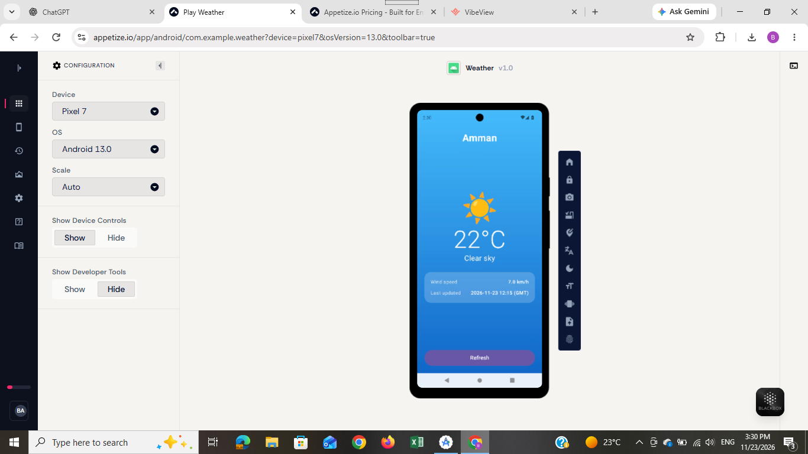
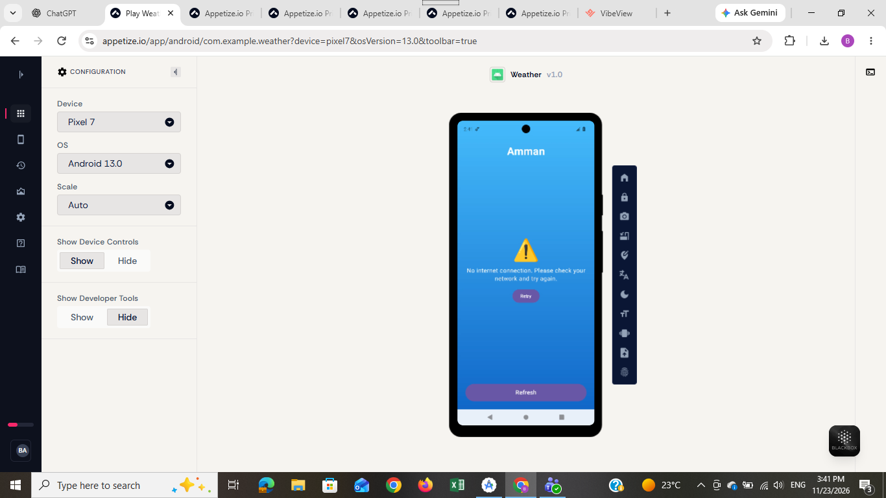

# Weather App (Amman)

A simple native Android app that fetches the current weather for Amman, Jordan from the Open-Meteo API and shows it in a clean UI, with proper loading and error handling.

## Screenshots

| Success | Error |
|---|---|
|  |  |

## Features

- City name (Amman) at the top
- Large temperature display in Celsius
- Weather condition text and icon, mapped from the weather code
- Details card with wind speed and last updated time
- Refresh button to fetch the data again
- Loading state with a progress indicator
- Error state with a clear message and a Retry button (no internet, timeout, bad response)

## Technologies

- Kotlin
- Native Android (Jetpack Compose, Material 3)
- ViewModel + StateFlow for state management
- Kotlin Coroutines
- `HttpURLConnection` and `org.json` for networking (no extra libraries)

## API

Open-Meteo Forecast API (free, no API key):

```
GET https://api.open-meteo.com/v1/forecast?latitude=31.95&longitude=35.91&current_weather=true
```

Fields used from `current_weather`: `temperature`, `windspeed`, `weathercode`, `time`.

Note: Open-Meteo returns the time in GMT by default, so the app labels it as GMT.

## Project Structure

```
app/src/main/java/com/example/weather/
├── MainActivity.kt                 # Entry point
├── model/WeatherData.kt            # Data class for the weather values
├── network/WeatherApiService.kt    # API request and JSON parsing
├── data/WeatherRepository.kt       # Wraps results, converts errors to messages
├── util/WeatherCodeMapper.kt       # Weather code to text and icon
└── ui/
    ├── WeatherUiState.kt           # Loading / Success / Error states
    ├── WeatherViewModel.kt         # Holds state, triggers fetch
    └── WeatherScreen.kt            # Compose UI
```

The networking logic (`network`, `data`) is fully separated from the UI (`ui`).

## How to Run

1. Install [Android Studio](https://developer.android.com/studio).
2. Clone the repository:
   ```
   git clone <repository-url>
   ```
3. Open the project folder in Android Studio and wait for the Gradle sync to finish.
4. Connect an Android phone (USB debugging on) or start an emulator.
5. Select the `app` configuration and click Run.

The app needs an internet connection to load the weather.